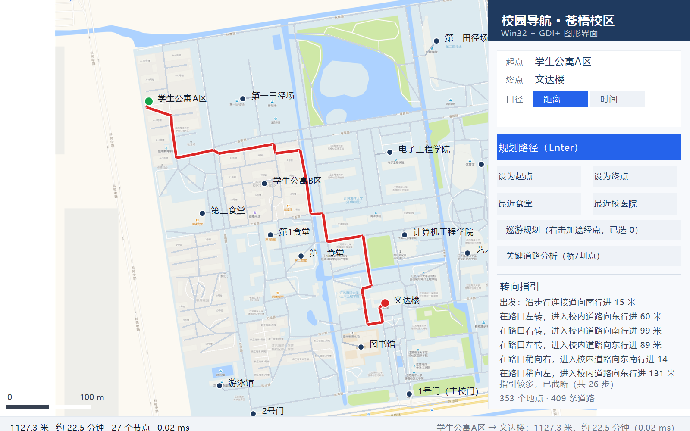

# 校园导航系统（图的最短路径）

[](https://github.com/CR7Jialuo/UseOfTu/actions/workflows/ci.yml)

> 本科毕业设计（论文）· C11 · Win32 + GDI+ · 江苏海洋大学苍梧校区真实路网

用**无向带权图**建模校园路网，实现两点最短路、转向指引、多点巡游、最近设施、全源最短路、
关键道路（割点/桥）分析、最小生成树，并提供**命令行**与**图形界面**两套入口，核心算法完全共用。



## 亮点

| 项 | 说明 |
|---|---|
| 真实路网 | 从高德底图提取，353 个节点（20 个地点 + 333 个路口）、409 条道路、总长 22.4 km，全连通 |
| 双前端 | `nav.exe` 命令行 + `navgui.exe` 图形界面，同一核心库，算法零重复 |
| 八类算法 | Dijkstra / Floyd / Bellman-Ford / BFS / Tarjan / Prim / Kruskal / Held-Karp |
| 可测试 | 22 组、1592 项断言，14 个端到端场景，GitHub Actions 持续集成 |
| 可复现 | 全新 clone 即可构建运行；数据、底图、脚本、文档全部入库 |

## 快速开始（Windows）

```bat
build.cmd          :: 编译命令行版  -> build\nav.exe
build_gui.cmd      :: 编译图形版    -> build\navgui.exe
test.cmd           :: 单元测试（1592 项断言）
run_gui.cmd        :: 打开图形界面（自动定位 data\campus_real）
```

已经编译好的可直接双击 `build\navgui.exe`；**提交包内**的可执行文件在 `bin\` 下，
推荐用包内的 `run_gui.cmd`（自动适配 `bin\` / `build\` 两种布局，并规避 SmartScreen）：

```bat
run_gui.cmd
```

> 图形界面会按“当前目录 → exe 同级 → exe 上一级”顺序寻找 `data\campus_real`，
> 因此双击、从任意目录启动、放进提交包解压后运行都能正常加载数据。

Linux / CI：

```bash
make && make test && make e2e
```


> **首次运行提示（SmartScreen）**：从网上下载/解压后，双击 `navgui.exe` 可能弹
> 「Windows 已保护你的电脑」。这是 SmartScreen 对**带“网络来源”标记的未签名程序**的例行拦截。
> 解决办法：双击 `第一次运行.bat` 或 `run_gui.cmd` —— 它们会把 exe 复制到
> `%LOCALAPPDATA%\CampusNav\`（重写字节，自动丢掉网络标记）再启动，因此不会再弹窗。
> 直接双击 `build\navgui.exe` 才会遇到该提示（本机自己编译的 exe 不带标记，不会弹）。

## 命令行示例

```bash
nav --data data/campus_real check                  # 校验数据：353 地点 / 409 道路 / 连通
nav --data data/campus_real route 1 5              # 1号门 -> 图书馆（含逐段转向指引）
nav --data data/campus_real route 18 6 --by time   # 按步行时间（学生公寓A区 -> 文达楼）
nav --data data/campus_real route 1 5 --json       # JSON 输出，便于脚本比对
nav --data data/campus_real tour 1 5 6 7           # 多点巡游，顺序自动优化
nav --data data/campus_real near 3 canteen         # 最近的食堂
nav --data data/campus_real critical               # 割点与桥（141 / 190）
nav --data data/campus_real mst                    # 最小生成树（Prim 与 Kruskal 互校验）
nav --data data/campus_real bench --nodes 100      # 算法基准
```

## 图形界面

| 操作 | 说明 |
|---|---|
| 滚轮 | 以光标为中心缩放 |
| 按住拖动 | 平移地图 |
| 单击地点 | 选中（右侧栏与状态栏同步显示） |
| `1` / `2` | 把选中地点设为起点 / 终点 |
| `Enter` | 规划路径（逐段播放动画） |
| `+` / `-` / `Home` | 放大 / 缩小 / 适应窗口 |
| 方向键 | 平移视图 |
| `空格` | 重播路径动画 |
| `T` / 右击地点 | 多点巡游：右击添加/移除途经点，`T` 或菜单规划 |
| `Esc` | 清除路径 |
| 菜单「文件」 | 导出当前视图为 PNG |

右侧栏：起终点、距离/时间口径切换、规划按钮、最近食堂/校医院、关键道路开关、逐段转向指引。

离屏渲染（用于文档配图与回归检查）：

```bash
navgui.exe --data data/campus_real --shot out.png --route 1 5 --size 1440x920
navgui.exe --data data/campus_real --selftest        # 开窗 0.8 秒自动关闭，冒烟测试
navgui.exe --data data/campus_real --open 5          # 启动即定位到 5 号地点
navgui.exe --shot out.png --route 18 6 --dpi 144     # 按 144 DPI 缩放渲染（验证高 DPI 布局）
```

## 目录结构

```text
campus-nav/
├─ include/          公共头文件（nav/campus/graph/algo/app/ui/platform/crc32/bench/err）
├─ src/              核心实现与命令行入口
├─ gui/              图形界面（gui.h / gui.c / render.c / main.c）
├─ tests/            自动化测试（独立编译，直接链接核心 .c）
├─ data/campus/      示意数据（24 地点 / 41 道路），用于测试
├─ data/campus_real/ 真实数据（353 节点 / 409 道路，含底图与折线）
├─ resources/        图标与资源脚本（app.ico / app.rc）
├─ scripts/          构建、测试、端到端、导出、推送
├─ docs/             报告、PPT、图表、模板与生成脚本
└─ .github/          CI 配置
```

## 算法一览

| 算法 | 复杂度 | 用途 |
|---|---|---|
| Dijkstra（二叉堆 + 惰性删除） | O((V+E)logE) | 单源最短路，交互查询 |
| Floyd-Warshall | O(V³) | 全源最短路矩阵 |
| Bellman-Ford | O(VE) | 负权与负环检测 |
| BFS | O(V+E) | 最少路段数路径 |
| Tarjan | O(V+E) | 割点与桥 |
| Prim / Kruskal | O(V²) / O(ElogE) | 最小生成树，互相校验 |
| Held-Karp + 2-opt | O(2^k·k²) | 多点巡游（k≤12 精确，否则近似） |

## 真实路网怎么来的

1. 底图标定：0.492 m/px，2572×2582；
2. 湖面配准：参考图与路网图之间求相似变换（尺度 1.5086），四个校门落点误差 3.7~12 m；
3. 拓扑化简：496 节点 / 563 边 → 去自环、重复边、零长边 → 合并二度点 → 319 路口 / 376 边；
4. POI 投影：20 个地图编号地点投影到最近道路，生成单支路连接。

结果：353 节点 / 409 边 / 22.4 km，全连通，每个地点度数均为 1。

## 测试与 CI

- 单元测试：22 组 1592 项断言（工具层、数据层、算法层、应用层）
- 随机交叉验证：30 张随机图上 Dijkstra / Floyd / Bellman-Ford 结果互比
- 端到端：14 个场景，覆盖全部子命令与错误路径
- CI：GitHub Actions 两个作业
  - `build-and-test`（Linux）：`make && make test && make e2e`
  - `windows-gui`（Windows Server）：装 MinGW → 构建 CLI+GUI → 跑测试 → 离屏渲染并上传截图

## 文档

- `docs/课程设计报告.docx` / `.pdf`：按学校毕业设计模板排版（27 页）
- `docs/答辩演示.pptx`：12 页答辩幻灯片
- `docs/PROGRESS.md`：开发进度与已知问题
- `docs/tools/`：报告、PPT、图表、图标、数据导出等生成脚本（可复现）

## 许可

课程设计作业，仅供学习参考。
